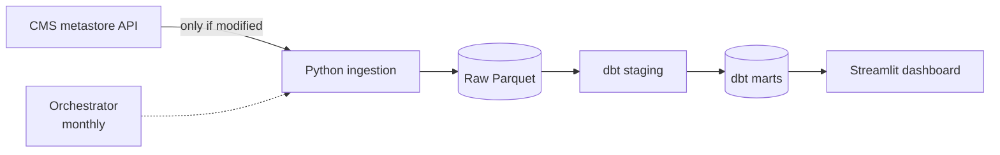

# CMS Hospital Quality Pipeline


> 🚧 **Work in progress.** Built milestone by milestone; see the [roadmap](#roadmap).

An end-to-end data pipeline on **public CMS (Centers for Medicare & Medicaid Services) data** that answers:

**Which U.S. hospitals are penalized for excess readmissions, and how does that relate to patient experience, hospital type, ownership and state?**

## Data sources

All from the [CMS Provider Data Catalog](https://data.cms.gov/provider-data/), which is public and needs no API key:

| Dataset | Used for |
|---|---|
| Hospital General Information | Hospital dimension: type, ownership, state, overall star rating |
| Hospital Readmissions Reduction Program (HRRP) | Excess readmission ratios by condition (> 1.0 = penalized) |
| Patient survey (HCAHPS) – Hospital | Patient-experience ratings |
| Unplanned Hospital Visits – Hospital | Readmission and return-visit measures |

## Planned architecture



## Roadmap

| Milestone | Status |
|---|---|
| 0. Project skeleton, CI | ✅ |
| 1. Incremental ingestion from the CMS API | ⏳ |
| 2. dbt staging models | ⏳ |
| 3. Marts and data-quality tests | ⏳ |
| 4. Orchestration | ⏳ |
| 5. Cloud warehouse | ⏳ |
| 6. Dashboard (live demo) | ⏳ |
| 7. Findings and write-up | ⏳ |

## Setup

```bash
python3 -m venv .venv && source .venv/bin/activate
pip install -e ".[dev]"
make check          # lint + tests + dbt build
```

> **macOS with python.org Python:** if installs or downloads fail with `CERTIFICATE_VERIFY_FAILED`, run `/Applications/Python 3.11/Install Certificates.command` once.

## Project layout

```
src/cms_pipeline/   Python ingestion code
tests/              pytest suite (fixtures in tests/fixtures/, no network)
dbt/                dbt project (DuckDB locally): staging → intermediate → marts
data/               local raw data + DuckDB file (git-ignored)
```
